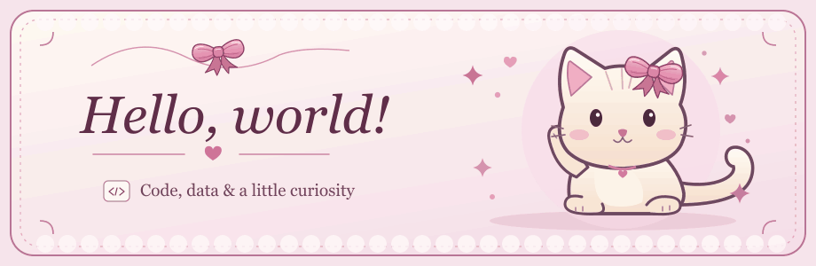

  

<h1 align="center">Hi, I’m Çağla Kefelioğlu 🎀</h1>

  <strong>Full-Stack Developer · Software Engineer</strong> 
  M.Sc. student in Machine Learning

  I build web and mobile applications from scratch. 
  I’m exploring where big data, AI, and software engineering meet.

  
  

## Tech stack

**Backend & data**

  
  
  

**Frontend & mobile**

  
  
  
  
  

**Tools & platforms**

  
  
  
  

## GitHub activity

  
  

  

